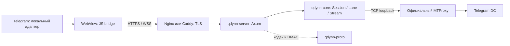

# Архитектура Qdynn-Bridge

Rust relay передаёт непрозрачные байты и не реализует MTProto или direct-to-DC соединения. TLS завершает внешний Nginx или Caddy.

## Границы компонентов

`qdynn-proto` содержит бинарный формат, потоковый декодер и строгий декодер целого транспортного сообщения. Перед применением проверяются границы batch, форма фреймов и направление. HMAC capability привязан к configured hostname.

`qdynn-core::SessionRegistry` хранит ограниченное число bootstrap-токенов и сессий с отдельными глобальными и per-profile caps. Повтор корректного HELLO в течение bootstrap TTL возвращает ту же открытую сессию. Cache bootstrap хранит слабую ссылку и не продлевает жизнь закрытой сессии.

Bootstrap/session caps и общий API/WS admission задаются конфигурацией процесса. `/down` имеет отдельный подлимит в 75% общего API admission, чтобы long polls не занимали управляющие слоты. Private `/metrics` публикует только фиксированные endpoint/status/reason/outcome labels, latency buckets API, backend phases и recovery. Bridge может один раз сообщить на bootstrap token фиксированный код startup/runtime failure; текст исключения не передаётся. Bearer, session ID, IP и hostname в labels не используются. Время до корректного MTProto handshake relay не измеряет.

`Session` сериализует изменение протокольного состояния короткой async-блокировкой. Валидация всего batch выполняется по снимку до применения его фреймов. DashMap guard не удерживается во время сетевого ожидания. Соединение с backend начинается в отдельной задаче, поэтому OPEN не задерживает обработку соседних потоков.

`Lane` содержит собственные очередь, uplink sequence/digest, retained downlink/cursor и признак прикреплённого WebSocket. Multiplexed carrier использует lane 0; lanes используют отдельные очереди stream ID. HTTP control lane 0 принимает PONG. Повтор uplink не повторяет запись в TCP. Downlink хранится до ACK cursor; новая poll-попытка отменяет старую, не забирая её данные.

`Stream` содержит два кредита по 4 MiB. Backend читается только в пределах выданного клиентом кредита. Клиентские DATA расходуют receive credit, который возвращается WINDOW после записи в backend. Одна задача владеет обоими направлениями и закрывает оба при EOF, ошибке или отмене. Отмена охватывает dial, read, write, ожидание кредита и очереди. `BackendConnector` задаёт cancellable async I/O seam; production default остаётся TCP adapter, подменить его можно при сборке `SessionRegistry`.

`qdynn-core::queue` учитывает payload и стоимость элемента. DATA имеют отдельные разрешения от управляющих фреймов. Перед выдачей batch multiplexed carrier применяет DRR по stream ID с квантами до максимального relay frame вместе с заголовком; кадры одного потока сохраняют FIFO, а готовые потоки получают обслуживание по очереди. Управляющие кадры получают приоритет burst-ами не более восьми подряд, если готовы DATA, поэтому они не вытесняют DATA бесконечно. Заряды снимаются при освобождении элементов; retained HTTP body и отправляемый WS batch учитываются отдельно. Это бюджеты данных и очередей, а не жёсткий лимит RSS процесса.

`qdynn-server::carriers/http.rs` обслуживает HTTPS и HTTPS lanes; `carriers/ws.rs` — multiplexed и lane WebSocket. Carrier закреплён за сессией, а не глобально за процессом. Opt-in `carrier_mode = "auto"` разрешает fallback `websocket` → `https` при стартовом отказе или неудачном WS opening во время recovery, в пределах одного общего deadline; default остаётся фиксированным `websocket`. Общие проверки находятся в `carriers/mod.rs`. WS upload/download выполняются scoped futures: проигравшая ветвь select отменяется, а не остаётся отсоединённой задачей. HTML-оболочка включает JS из `crates/qdynn-server/src/bridge.js`. Его startup ограничен абсолютным бюджетом 15 секунд; тело session/down читается потоково с ограничением размера; multiplexed WebSocket opening ограничен оставшимся startup budget и максимумом 4 секунды, lane opening — 4 секунды. Завершение страницы и timeout отменяют запросы, поздний `onopen` не восстанавливает закрытый socket.

## Ограничения и завершение

Пределы по умолчанию: 128 зарегистрированных сессий, 1024 bootstrap-токена и 256 одновременных API запросов/WS подключений. Также конфигурируются byte budgets, размеры очередей, 32 активных потока на сессию, 129 состояний lanes (включая control lane) и 256 backend-подключений на процесс. Из общего API admission long polls `/down` могут занять не более 75%. Завершённые lanes освобождаются после закрытия WS или подтверждения HTTP downlink.

Общий бюджет данных — 128 MiB, на сессию — 16 MiB. Входящие HTTP/WS body имеют отдельный общий резерв 64 MiB; для HTTP он запрашивается до чтения body. Резерв управляющих фреймов — 4 MiB на процесс и 128 KiB на сессию. Очередь lane имеет 128 элементов, из которых DATA могут занимать 96. В uplink stream максимум 4096 элементов, а байты также ограничены receive credit и общим бюджетом. Tombstones хранят последние 4096 stream ID; идентификаторы назначает клиент и не должен повторно использовать.

Максимум batch — 2 MiB и 4096 фреймов; payload одного фрейма — 1 MiB, backend chunk — до 64 KiB. Bootstrap TTL — 120 секунд, idle session TTL — 300 секунд. Backend dial ограничен 5 секундами, запись backend — 30; WS write — 10, heartbeat — 25, ожидание сообщения/PONG — 50 секунд.

CLOSE, DELETE, потеря carrier и остановка процесса отменяют соответствующие задачи. Потеря одного установленного WS lane закрывает его поток; потеря multiplexed WS закрывает сессию. Приватный admin listener опционален и отделён от публичного сайта.

Несколько профилей, base path и встроенный TLS пока не реализованы. Отсутствует измеренное сравнение производительности с официальным сервером; меньшая задержка из-за устранения блокирующего dial — архитектурное изменение, а не результат benchmark.

## Диагностика и установка

`check-config` валидирует настройки без запуска listener. `doctor` запускает встроенный Python-скрипт через stdin с отдельной capability и общим timeout 90 секунд; стандартная библиотека Python проверяет публичный TLS и HTTP/WS handshake. Python нужен только для диагностики, новых TLS-зависимостей или фоновых компонентов relay нет. Комплект `deploy/` управляет локальным бинарником/config/systemd и откатом; Nginx и MTProxy остаются существующими внешними компонентами.

Проверка доступа выполняется внешним middleware до method routing: неавторизованные API получают обычный публичный ответ без добавленного Axum `Allow`. Down-poll admission применяется после авторизации. JS-учёт native streams и remote CLOSE читает метаданные кадров без копирования payload; копии создаются при действительном разделении кадров или фильтрации старых потоков.
